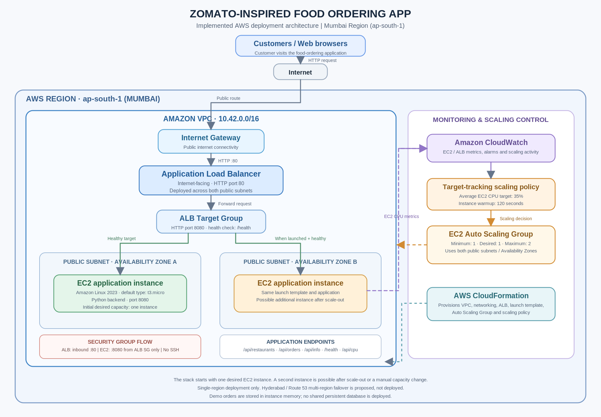

# Zomato Cloud Lab — AWS Scalability Case Study

An educational, Zomato-inspired food-ordering web application used to demonstrate **AWS load balancing, EC2 Auto Scaling, infrastructure automation, and performance testing**.

> **Project scope:** This is an academic demonstration, not Zomato's real application or production architecture. The implemented AWS deployment is **single-region (Mumbai, `ap-south-1`)**. A Mumbai–Hyderabad multi-region design is discussed as a possible extension only; it is **not deployed or tested** by this repository.

## Architecture



The implemented deployment consists of:

- One Amazon VPC with two public subnets in separate Availability Zones.
- An internet-facing Application Load Balancer (HTTP port 80).
- An ALB target group that forwards traffic to the Python application on port 8080 and checks `/health`.
- An EC2 Auto Scaling Group configured for a minimum of 1, desired 1, and maximum of 2 instances.
- A target-tracking policy with a 35% average CPU utilization target and 120-second estimated instance warmup.
- Amazon CloudWatch metrics and scaling activity.
- AWS CloudFormation to provision the infrastructure.

The group initially requests **one** EC2 instance. A second instance may be launched by scaling or by a manual capacity change; having two subnets does not mean two instances are running all the time.

See [`docs/ARCHITECTURE.md`](docs/ARCHITECTURE.md) for the implemented and proposed architectures.

## Application features

- Restaurant listing served by a Python HTTP backend.
- Simple HTML/CSS/JavaScript frontend.
- Demo order endpoint with input validation.
- Health-check endpoint for the ALB target group.
- Instance/region information endpoint.
- Bounded CPU-work endpoint for controlled load experiments.
- Unit tests and a bounded HTTP load-testing script.

## Run locally

The local demo uses Python's standard library; no AWS account is needed to run the app or its tests.

### 1. Clone the repository

```bash
git clone https://github.com/YOUR-USERNAME/YOUR-REPOSITORY.git
cd YOUR-REPOSITORY
```

### 2. Start the application

```bash
python app/server.py
```

Open [http://localhost:8080](http://localhost:8080) in your browser.

### 3. Run the tests

In a second terminal, from the repository root:

```bash
python -m unittest discover -s tests -v
```

## API endpoints

| Method | Endpoint | Description |
|---|---|---|
| `GET` | `/` | Serves the food-ordering frontend |
| `GET` | `/health` | Health check used by the ALB |
| `GET` | `/api/restaurants` | Returns the demo restaurant list |
| `GET` | `/api/info` | Returns the region and instance hostname |
| `GET` | `/api/cpu` | Performs bounded CPU work for load experiments |
| `POST` | `/api/orders` | Validates and accepts a demo order |

Example order request:

```bash
curl -X POST http://localhost:8080/api/orders \
  -H "Content-Type: application/json" \
  -d '{"restaurant_id": 1}'
```

## Generate and validate the CloudFormation template

The committed template is `infra/zomato-stack.yaml`. If you change the app files, regenerate the embedded application bundle:

```bash
python -m pip install -r requirements-dev.txt
python scripts/generate_template.py
```

If you have the AWS CLI configured, validate the template before deployment:

```bash
aws cloudformation validate-template \
  --template-body file://infra/zomato-stack.yaml \
  --region ap-south-1
```

## Optional AWS deployment

Read [`docs/DEPLOYMENT.md`](docs/DEPLOYMENT.md) and [`docs/COST_SAFETY.md`](docs/COST_SAFETY.md) completely before deploying. The stack can create billable EC2, Application Load Balancer, public IPv4, CloudWatch, and data-transfer resources. **There is no zero-cost guarantee.** Use an authorized AWS account, review current prices and budgets, restrict `OperatorCidr` where possible, and delete the stack immediately after the supervised experiment.

The deployment is HTTP-only and intended for a temporary lab demonstration. Do not enter passwords, payment details, or personal information.

## Performance experiment

The project includes a bounded load tester. Use it only against infrastructure you own or are authorized to test.

```bash
python scripts/load_test.py \
  --url http://YOUR-LOAD-BALANCER-DNS \
  --requests 100 \
  --workers 5 \
  --output evidence/one-instance.csv
```

Repeat the same test after confirming that **two targets are healthy**. Record the actual instance count observed in AWS, combine the measured CSV rows, and generate a chart:

```bash
python scripts/plot_results.py evidence/combined.csv evidence/latency.png
```

Do not invent performance results. Distinguish a manually configured one-versus-two-instance comparison from evidence that the automatic scaling policy actually triggered. See the deployment runbook for the full experiment and cleanup steps.

## Repository structure

```text
.
├── app/
│   ├── index.html
│   └── server.py
├── docs/
│   ├── images/
│   │   ├── zomato-aws-architecture.png
│   │   └── zomato-aws-architecture.svg
│   ├── ARCHITECTURE.md
│   ├── COST_SAFETY.md
│   ├── DEPLOYMENT.md
│   ├── REPORT_TEMPLATE.md
│   └── TEAM_GITHUB_3_DAYS.md
├── evidence/
├── infra/
│   └── zomato-stack.yaml
├── scripts/
│   ├── generate_template.py
│   ├── load_test.py
│   └── plot_results.py
├── tests/
│   └── test_app.py
├── .gitignore
├── README.md
└── requirements-dev.txt
```

## Known limitations

- There is no shared persistent database. Demo orders are held in each Python process's memory, are not shared between EC2 instances, and disappear when an instance restarts or is replaced.
- Restaurant data is hard-coded; the app has no user authentication, payment processing, or real delivery workflow.
- The deployment uses HTTP, not HTTPS, and is not production-hardened.
- The implemented CloudFormation stack is single-region. The Hyderabad region, Route 53 failover, and cross-region data strategy are proposals, not deployed features.
- The load-test comparison measures a small demonstration workload; results depend on traffic, instance readiness, and the AWS environment.

## Tools and technologies

Python, HTML, CSS, JavaScript, Amazon EC2, Application Load Balancer, EC2 Auto Scaling, Amazon CloudWatch, AWS CloudFormation, and the AWS CLI.

## Disclaimer

This is an independent educational project inspired by a food-delivery use case. It is not affiliated with, endorsed by, or operated by Zomato. Product names and AWS marks belong to their respective owners.
