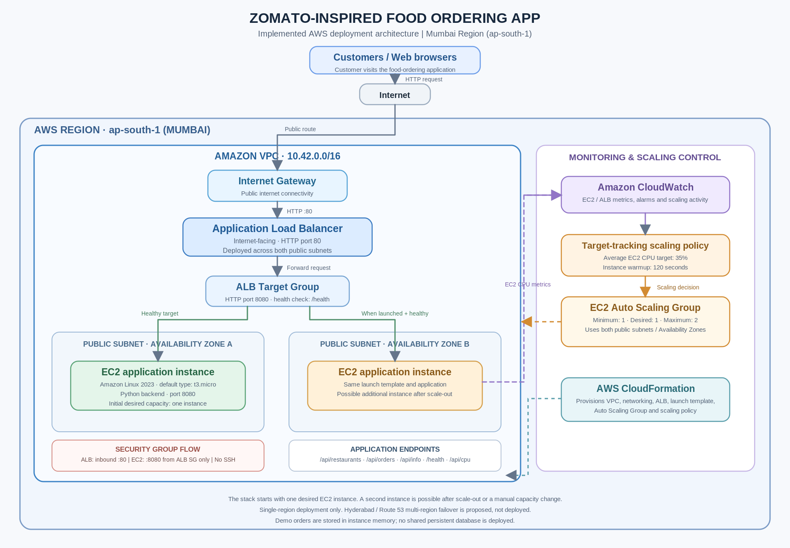

# Architecture and scope

## Implemented AWS deployment — single region

The CloudFormation template deploys the application in one AWS Region, Mumbai (`ap-south-1`):

1. One VPC (`10.42.0.0/16`) with an Internet Gateway, route table, and two public subnets in distinct Availability Zones.
2. An internet-facing Application Load Balancer listening on HTTP port 80.
3. An ALB target group that forwards HTTP traffic to port 8080 and checks `/health`.
4. A launch template using Amazon Linux 2023, IMDSv2, application bootstrap through user data, and a systemd service.
5. An EC2 Auto Scaling Group with minimum 1, desired 1, maximum 2; target-tracking scaling uses a 35% average CPU target and 120-second estimated instance warmup.
6. Security groups allow HTTP to the ALB and allow only the ALB security group to reach the instances on port 8080. There is no SSH ingress rule.
7. CloudWatch provides the EC2/ALB metrics and scaling activity used to observe the deployment. The template does not create a custom application log group.

The ASG starts with one desired instance and can place instances in either configured subnet. A second instance is possible after scale-out or a manual capacity change; two configured Availability Zones do not imply two running instances at all times.

## Request flow

Browser → Internet → Internet Gateway → ALB → healthy EC2 instance → application endpoint (`/`, `/api/restaurants`, `/api/orders`, `/api/info`, `/health`, or `/api/cpu`).

## Security groups

- ALB security group: inbound HTTP port 80 from the configured `OperatorCidr` (default `0.0.0.0/0`).
- Application security group: inbound TCP port 8080 only from the ALB security group.
- No direct SSH ingress is configured.

The demo is HTTP-only and is not production-hardened. Restrict the ALB CIDR where possible and do not submit private information.

## Proposed multi-region extension — not deployed

The conceptual design considers a second region (Hyderabad), Route 53 latency/failover routing, separate regional ALBs and Auto Scaling Groups, and a database replication/consistency strategy. These are design ideas only; this repository does not deploy or test them.

A real regional failover design would require two independently deployed regional stacks, health-aware DNS routing, and a deliberate shared-data replication/consistency strategy. Regional cost, DNS propagation, active-active write conflicts, and cross-region data transfer have not been measured here.

## Experiment interpretation

For a controlled one-versus-two-instance comparison, manually set desired capacity to 1 and then 2, wait for the required number of healthy targets, and run the same bounded load test. This is a manual capacity comparison. Separately, observe CloudWatch metrics and ASG activity to gather evidence of automatic target-tracking behavior; the policy may take several minutes to trigger and a short test may not trigger it.

## Application data limitation

Orders are stored in a process-local Python list. They are not shared across EC2 instances and are lost on restart or replacement. Do not claim that the demo provides reliable or transactional order processing.
